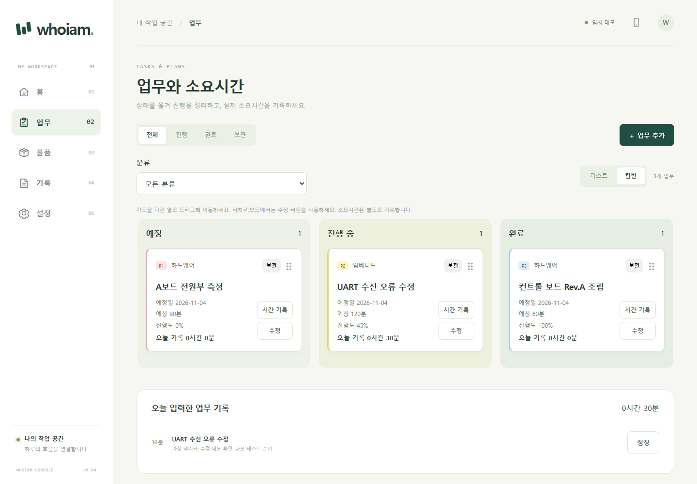

# whoiam(후임) — 개인 업무비서

업무·구매·재고·근무 기록과 일일 보고를 연결하는 **로컬 업무비서**입니다. Windows 개인 사용을 위한 v0.05이며, 브라우저에서 조작합니다.

한글 이름은 **후임**입니다. 반복되는 일을 챙기고 다음 할 일을 함께 정리하는 업무 동료를 뜻합니다.



- **업무**: 리스트·칸반, 분류·우선순위, 예상시간·진행도·시간 기록, 원클릭 보관
- **물품**: 구매·배송 예정·증빙, 재고·BOM·조립 소모
- **근무**: 출퇴근·휴게·수동 정정, 주간 합계·급여 입금 대조
- **보고**: 일일 업무 초안 편집, 한 장 PNG와 복사 가능한 텍스트 메시지
- **보관함**: 로컬 암호화 저장·백업·복구, 로그인 정보 일시 조회

## 실행

Python 3.11 이상이 필요합니다. 프로젝트 폴더에서 실행합니다.

```powershell
py -3 -m venv .venv
.\.venv\Scripts\python.exe -m pip install -r requirements.txt
.\.venv\Scripts\python.exe -m apps.server --demo=True
```

브라우저가 자동으로 열립니다. 데모는 **가상 데이터만 사용하며 종료 시 삭제**됩니다.
실제 사용은 데모를 종료한 뒤 `--demo=True` 없이 실행하고, 자동으로 열린 창에서 직접 잠금을 해제합니다.

**[다른 PC 설치 가이드 · CLI AI에게 붙여 넣을 요청문](docs/setup.md)**

앱 안의 **도움말 ⓘ**에서 빠른 시작, 기능별 사용법, 근무 산정 규칙, 백업·복구·연결 문제 안내를 볼 수 있습니다. PC에서는 메뉴 하단, 작은 화면에서는 상단의 도움말 버튼을 사용합니다.

## 데이터와 배포

운영 데이터는 checkout 밖 `%LOCALAPPDATA%\Whoiam\.private\production\`에 암호화하며, 키는 Windows 계정의 OS 보안 저장소에 분리합니다.
실제 정보·데이터·키·백업을 GitHub에 올리지 않습니다. 지원 범위는 개인용 로컬 실행이며 외부 공개 서버는 지원하지 않습니다.

배포 ZIP은 검토한 실행 파일만 포함하고 `.git`·운영 데이터·개발 가상환경을 제외합니다. 스크린샷도 메모리 데모로만 생성합니다.
Git 이력 정리 결과와 점검 범위는 **[배포 준비 점검 결과](docs/release-readiness.md)**에서 확인합니다.

## 문서

- [설치와 AI 설치 요청문](docs/setup.md) · [백업·복구·자동 실행](docs/personal-service.md)
- [배포 점검](docs/release-readiness.md) · [민감정보 정책](docs/security.md)
- [개발 규칙](CONTRIBUTING.md) · [프로젝트 구조](docs/architecture.md) · [API](docs/api.md)

구조는 `apps/web`(화면), `apps/server`(FastAPI), `packages/modules`(업무별 모듈), `packages/platform`(저장·키·복구)으로 나뉩니다.
판매처 자동 구매·실시간 배송 조회·급여 세금 계산·MCU 펌웨어는 후속 범위입니다.
